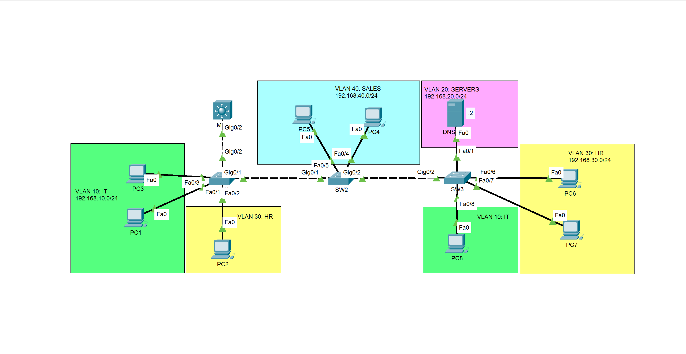

# Cisco VTP & DTP Lab — VLAN Management, DHCP and DNS

## Overview

This project demonstrates VLAN management and trunk negotiation in a Cisco switched network using **VLAN Trunking Protocol (VTP)** and **Dynamic Trunking Protocol (DTP)**.

The lab also explores centralized DHCP services on a Multilayer Switch (MLS) and DNS name resolution using a dedicated DNS server.

Built and tested in Cisco Packet Tracer, this lab focuses on VLAN administration, inter-switch connectivity, automated IP addressing, and basic network service integration.

## Objectives

- Configure VTP server, client, and transparent modes.
- Understand how VTP distributes VLAN information across switches.
- Configure and verify DTP trunk negotiation.
- Establish trunk links between network switches.
- Configure a Multilayer Switch as a DHCP server.
- Configure DNS services on a dedicated server.
- Verify host addressing and end-to-end connectivity.

## Network Topology



The topology consists of a Multilayer Switch, three access switches, multiple end hosts, and a dedicated DNS server.

## Switching Architecture: VTP and DTP

### VTP Configuration

The lab uses **VTP version 2** with the following roles:

| Device | VTP Mode | Function |
|---|---|---|
| MLS | Server | Creates and manages VLAN information |
| SW1 | Client | Learns VLAN information from the VTP server |
| SW2 | Client | Learns VLAN information from the VTP server |
| SW3 | Transparent | Maintains an independent VLAN database |

**VTP domain:** `CCNA`

VTP allows VLAN information to be distributed between participating switches within the same VTP domain.

In transparent mode, SW3 maintains its own VLAN database rather than synchronizing it with the VTP server.

### DTP and Trunk Links

Inter-switch trunk links are configured manually using:

```cisco
switchport mode trunk
```

This explicitly configures the switchport as a trunk instead of relying on dynamic trunk negotiation.

Although DTP is part of the lab's learning objectives, a manually configured trunk should not be confused with a dynamically negotiated trunk. The actual negotiation behavior depends on the platform and interface configuration.

## Inter-VLAN Routing

The Multilayer Switch performs Layer 3 routing between the four VLANs using Switched Virtual Interfaces (SVIs).

| SVI | IP Address | VLAN |
|---|---|---|
| `interface vlan 10` | `192.168.10.254/24` | IT |
| `interface vlan 20` | `192.168.20.254/24` | SERVERS |
| `interface vlan 30` | `192.168.30.254/24` | HR |
| `interface vlan 40` | `192.168.40.254/24` | SALES |

Each SVI serves as the default gateway for hosts in its corresponding VLAN.

## DHCP and DNS Services

### DHCP Server

The Multilayer Switch provides DHCP address allocation for the network's VLANs.

The DHCP configuration supplies the appropriate IP addressing information and default gateway to client hosts.

### DNS Server

A dedicated DNS server, `DNS-SVR`, is connected to VLAN 20.

- **IP address:** `192.168.20.2`
- **DNS record:** `DNS-SVR` → `192.168.20.2`

The lab verifies name resolution by pinging the DNS server using its configured hostname.

## Validation and Test Results

The following tests were performed successfully in Cisco Packet Tracer:

| Test | Result |
|---|---|
| Inter-VLAN connectivity | Passed |
| Connectivity to DNS-SVR by IP address | Passed |
| DNS name resolution using `DNS-SVR` | Passed |
| DHCP address allocation | Configured and tested as part of the lab |

The successful inter-VLAN tests validate routing through the MLS SVIs. The hostname-based ping confirms that the DNS record is resolving correctly in the lab environment.

## Key Technologies

- Cisco Packet Tracer
- VLANs and IEEE 802.1Q trunking
- VTP server, client, and transparent modes
- DTP trunk negotiation
- Multilayer switching
- DHCP address allocation
- DNS name resolution
- Network connectivity troubleshooting

## Repository Structure

```text
.
├── configs/
│   └── Device configuration files (.txt)
├── docs/
│   ├── documentation.md
│   └── topology.png
├── src/
│   └── VTP-DTP-Lab.pkt
├── tests/
│   ├── simulation-mode.png
│   ├── end-to-end-connectivity.png
│   ├── shows.txt
│   └── Additional verification screenshots
├── .gitignore
├── LICENSE
└── README.md
```

## Configuration and Verification

The configurations and supporting documentation are available in the repository.

The following checks can be used to validate the lab:

| Test | Expected result |
|---|---|
| `show vtp status` | Verify each switch's VTP mode and domain settings |
| `show vlan brief` | Verify the local VLAN database |
| `show interfaces trunk` | Verify operational trunk links and allowed VLANs |
| `show interfaces switchport` | Inspect switchport mode and DTP-related settings |
| `show ip dhcp binding` | Verify DHCP leases on the MLS |
| `ipconfig /all` on a PC | Inspect the assigned IP configuration |
| `ping <destination-IP>` | Test IP connectivity |
| DNS lookup using a configured hostname | Verify name resolution |

Actual results should be confirmed against the saved Packet Tracer simulation and screenshots.

## Learning Outcomes

This lab provides practical experience with:

- Centralized VLAN administration using VTP.
- The differences between VTP server, client, and transparent modes.
- Dynamic trunk negotiation and switch-to-switch connectivity.
- DHCP services on a Multilayer Switch.
- DNS integration into a segmented LAN.
- Structured network validation and troubleshooting.

## Security Considerations

VTP and DTP should be configured deliberately in production networks.

- Disable DTP negotiation on ports where trunk negotiation is unnecessary.
- Configure access ports explicitly as access ports.
- Restrict trunk links to the VLANs that need to traverse them.
- Use an appropriate VTP domain, version, and authentication configuration.
- Consider VTP transparent mode or VTP off mode where appropriate for the network design.
- Apply switch hardening and access-control measures.

## Author

**C. Victorin Vodinou**

_Networking_ | _Systems Administration_ | _Network Security_

[GitHub Profile](https://github.com/Victorin13)
[LinkedIn Profile](https://www.linkedin.com/in/victorin-vodinou/)
Gmail Prifile: victorinvodinou@gmail.com

This project is part of my hands-on networking lab portfolio.

## License

This project is distributed under the MIT License. See [`LICENSE`](LICENSE) for details.